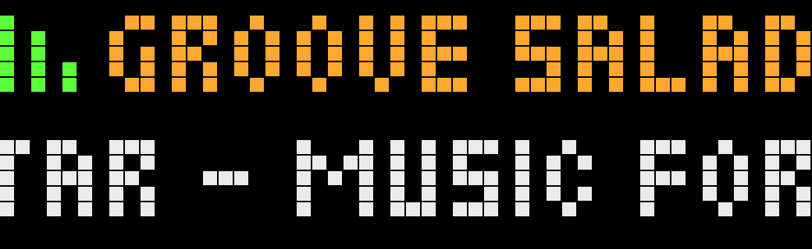
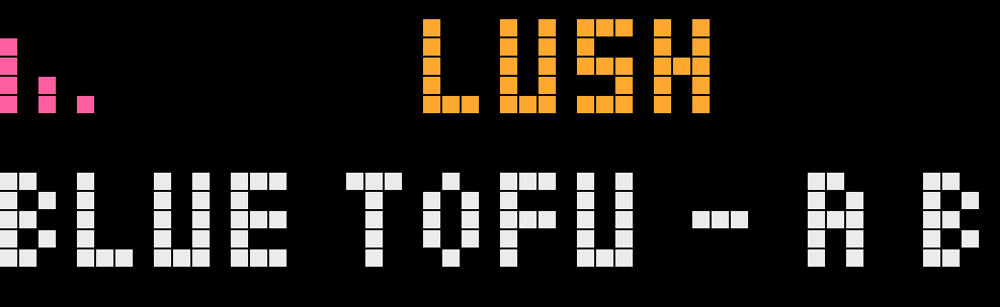
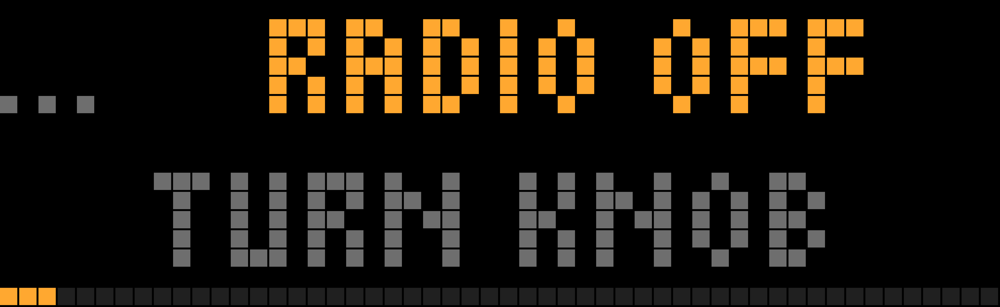

# SomaFM for AWTRIX-NG (Ulanzi TC002)

Listen to [SomaFM](https://somafm.com) on the TC002's own speaker and see what's playing, on its 52×16 LED display. It's one script, with no other scripts to install.

Unofficial hobby project, not affiliated with or endorsed by SomaFM but used with their permission. SomaFM is listener-supported, so please [support them](https://somafm.com/support/) if you enjoy it.

> **Building on this code?** SomaFM's streams and JSON files are not a free data feed, and this project's permission doesn't carry over to forks. Read their [Terms of Service](https://somafm.com/contact/tos.html) and [NOTICE.md](NOTICE.md) first, get your own permission and change the User-Agent.

| Groove Salad | Lush | Radio off |
|---|---|---|
|  |  |  |

The app has one view and one knob:

| Knob | What it does |
|---|---|
| **Turn** | Moves through **Radio off → ★ favourites → all channels**. What you stop on plays after 0.6 s |
| **Press** | Turning sets the volume (teal bar), until you stop for 2 s |
| **Hold** | Adds or removes the ★ favourite |

Line 1 shows the channel, and line 2 shows `Artist - Title`, or the genre until the title arrives. For 5 s after you use the knob, the rotation waits and the position bar and ★ are visible. ← / → and select keep their normal clock functions.

The app takes a normal turn in the rotation while SomaFM plays. While the radio is off, it takes a 4 s turn showing `Radio off / turn knob`, so you can start it from the clock.

## Files

| File | What it is |
|---|---|
| `scripts/somafm.be` | The app |
| `tools/gen_channels.py` | Regenerates the channel table and colours from somafm.com |
| `tools/logo_sheet.py` | Renders a local 16×16 preview of the channel logos (not committed; the logos are copyrighted by SomaFM, see [NOTICE.md](NOTICE.md)) |

## Install

**From the AWTRIX Hub (easiest):** open [SomaFM Radio](https://awtrix.de/script/lR85BD2PCMjm) and send it to your clock.

**By hand:** in the AWTRIX web UI, open **Scripts**, create a script with any name, paste `scripts/somafm.be` and save. Keep it active in the rotation.

**Updating from version 1:** after installing version 2, delete the old `SomaFM` tuner and `somafm_lib` from your clock. If you installed by hand under another name, delete the old card too.

## Settings (gear icon on the Apps tab)

**Show when radio is off:** turn this off to keep the app out of the rotation while the radio is off. You can then start the radio with hold select → **Radio**, or with **Show** on the web UI's Apps tab.

**Update channel list:** turn it on and press **Save** to download SomaFM's current channel list once. It turns itself off again.

**Saved stations:** you can also save SomaFM channels as stations in the web UI's Radio settings. Name each station exactly like the channel (for example `Groove Salad`), or include "SomaFM" in its name, so the app recognises it.

Radio off stops the radio by calling the clock's own REST API (`POST /api/v1/audio/stop`), because Berry has no stop call.

## Channel list

The app has all 51 channels built in, so it works offline and makes no requests for the list. When SomaFM adds or removes a channel, use **Update channel list** in the settings. It downloads SomaFM's `channels.json` once (58 KB, read with a string scan instead of `json.load`) and keeps it on the clock. That request sets this project's User-Agent. The audio streams can't: the firmware always sends `AWTRIX-NG` for them (see [NOTICE.md](NOTICE.md)). A channel that SomaFM adds later appears with a grey colour bar. To give it a colour, and to refresh the built-in list, run:

```sh
uv run tools/gen_channels.py      # rewrites the table in scripts/somafm.be
```

Then paste the updated `somafm.be` into the web UI again. To change a channel's colour by hand, add it to `OVERRIDES` in `tools/gen_channels.py`.

## Test status

Tested on a TC002 with firmware 1.2.3, version 2:
- turning through channels, with only the last one tuning after a quick turn
- the position bar and ★ while using the knob
- volume with a knob press, returning to channels after 2 s
- adding and removing a favourite with a knob hold
- stopping the radio by landing on Radio off, and turning right to start the first favourite
- the rotation waiting while the knob is in use, and continuing afterwards
- the `Radio off / turn knob` view, also while the firmware still reports the stopped station
- favourites carried over from version 1, and saved on the clock
- downloading `channels.json` with the User-Agent header set (in 2.0, when the knob was first used)
- a saved station named `Groove Salad` showing on the card with its title (2.1)
- **Update channel list** downloading the list once and switching itself off again (2.1, on two clocks)

Not tested on version 2:
- a station that can't connect showing `no signal`
- a favourite that SomaFM removes showing "off air", and a new channel appearing in grey

Not captured in any version: the exact User-Agent the clock sends for `channels.json`.

Known open question: an early version showed "no signal" while the stream was playing. It no longer happens, but the cause was never identified. If it comes back, check the `station:` lines in the log.

## License

[MIT](LICENSE) for this project's code only. SomaFM's name, streams, data, logos and other content belong to SomaFM and are not covered by that licence. See [NOTICE.md](NOTICE.md).
