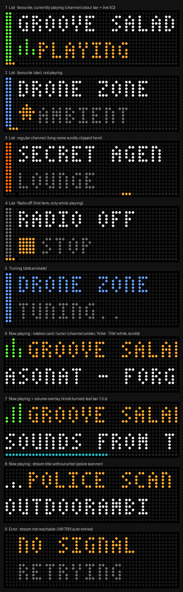

# SomaFM for AWTRIX-NG (Ulanzi TC002)

Listen to [SomaFM](https://somafm.com) on the TC002's own speaker and see what's playing, on its 52×16 LED display.

Unofficial hobby project, not affiliated with or endorsed by SomaFM but used with their permission. SomaFM is listener-supported, so please [support them](https://somafm.com/support/) if you enjoy it.

> **Building on this code?** SomaFM's streams and JSON files are not a free data feed, and this project's permission doesn't carry over to forks. Read their [Terms of Service](https://somafm.com/contact/tos.html) and [NOTICE.md](NOTICE.md) first, get your own permission and change the User-Agent.

- **SomaFM** (tuner, started from the menu): pick a channel and it plays. Your favourites come first, and the knob sets the volume.
- **SomaFM Now** (rotation card): while a SomaFM channel plays, it appears in the normal app rotation and shows the channel name on top and `Artist - Title` below. When nothing is playing, it hides.



## Files

| File | Install name | What it is |
|---|---|---|
| `scripts/somafm_lib.be` | `somafm_lib` | Shared module: channel table with colours, parsing and drawing helpers |
| `scripts/somafm.be` | `SomaFM` | Tuner (`@ondemand`) |
| `scripts/somafm_now.be` | `SomaFM-Radio` | Now-playing card for the rotation |
| `scripts/spike.be` | `SomaFM Spike` | Throwaway hardware test (see below) |
| `tools/gen_channels.py` | – | Regenerates the channel table and colours from somafm.com |
| `tools/mockup.py` | – | Renders `docs/mockups.png` |
| `tools/logo_sheet.py` | – | Renders a local 16×16 preview of the channel logos (not committed; the logos are copyrighted by SomaFM, see [NOTICE.md](NOTICE.md)) |

## Install

**From the AWTRIX Hub (easiest):** open [SomaFM Radio](https://awtrix.de/script/lR85BD2PCMjm), send it to your clock and choose **Install with dependencies**. That installs the card, the tuner and the shared library in one go.

**By hand:**

1. In the AWTRIX web UI, open **Scripts**. Create a script named **`somafm_lib`**, paste `scripts/somafm_lib.be` and save. Install the module first, because the other two import it.
2. Create **`SomaFM`** from `scripts/somafm.be`. It appears under "In the device menu".
3. Create a script from `scripts/somafm_now.be`, for example **`SomaFM-Radio`**, and keep it active in the rotation.
4. Optional: set the radio volume once in **Audio → Mixer** (`radioVolume`).

You can also install or update a script from a computer, without pasting. This replaces it only if the stored source still matches `expected_source`, and restores the old version if the new one doesn't compile (the install name here is your own):

```sh
curl -X PUT "http://<clock-ip>/api/v1/apps/script-update/SomaFM" \
  -H "Content-Type: application/json" \
  -d '{"expected_source":"<current source>","source":"<new source>"}'
```

## Use

Hold **select** → **Scripts** → **SomaFM**. The list opens on the channel that's playing, or on the last one you played.

| Input | Channel list | Now playing |
|---|---|---|
| ← / → | previous / next channel (hold = fast) | switch to the previous / next channel (tunes after 0.6 s) |
| Knob turn | previous / next channel | volume ±5 (teal bar at the bottom) |
| Select / knob press | play the channel (or open it if it's already playing). On **Radio off**: stop the radio | back to the list |
| Knob long press | ★ add or remove a favourite | ★ add or remove the current channel |
| Hold select | leave the app | leave the app |

After 10 s on the now-playing screen without input, the tuner closes and the clock goes back to its rotation (setting **Close after idle**). The list closes after 60 s without input. The radio keeps playing either way, and **SomaFM Now** shows it in the rotation.

The list order is: **Radio off** (only while something plays) → ★ favourites → all channels. The thin bar on the bottom row shows where you are in the list, with a small gap where the favourites end. The coloured bar on the left is the channel's **signature colour**, taken from its logo (Groove Salad green, Drone Zone ice-blue…). The same colour drives the live EQ bars while it plays.

### Knob remote on the SomaFM Now card

While the card is on screen, you don't need the menu:

| Input | Result |
|---|---|
| Knob turn | Next or previous favourite (tunes after 0.6 s) |
| Knob press | Open the tuner, for all channels and Radio off |

The tuner must be installed under the exact name `SomaFM`. The card gets your favourites from the tuner, so open the tuner once after installing. Until then, the knob keeps its normal function on the card. Turning the knob on the card no longer changes the volume there; use the tuner's now-playing screen instead.

## Settings (gear icon on the Apps tab)

**SomaFM**: `Close after idle` (s, 0 = never), `Large title`, `Accent colour`, `Clock API address`, `Update channel list online`.
**SomaFM Now**: `Large title`, `Channel name colour`, `Clock API address`.

**Radio off** stops the radio by calling the clock's own REST API (`POST /api/v1/audio/stop`), because Berry has no stop call. If "OFF FAILED" appears, set **Clock API address** to the clock's IP (e.g. `192.168.1.42`).

## Channel list

The tuner has all 51 channels built in, so it works offline and opens instantly. Once a day it also downloads SomaFM's `channels.json` in the background (58 KB, read with a string scan instead of `json.load`), so seasonal channels appear and disappear. That request sets this project's User-Agent. The audio streams can't: the firmware always sends `AWTRIX-NG` for them (see [NOTICE.md](NOTICE.md)). A channel that SomaFM adds later appears with a grey colour bar. To give it a colour, and to refresh the built-in list, run:

```sh
python3 -m venv .venv && .venv/bin/pip install -r tools/requirements.txt
.venv/bin/python tools/gen_channels.py      # rewrites the table in scripts/somafm_lib.be
.venv/bin/python tools/mockup.py            # re-renders docs/mockups.png
```

Then paste the updated `somafm_lib.be` into the web UI again. To change a channel's colour by hand, add it to `OVERRIDES` in `tools/gen_channels.py`.

## First run: hardware spike

Some firmware behaviour isn't documented, so check it once with `scripts/spike.be` (install it as **SomaFM Spike**, start it from the menu, and watch **System → Log**):

| Action | Checks | Expected |
|---|---|---|
| select | `sound.play({'station': url})` from a script, and what `music.station()` reports | Groove Salad plays; line 1 shows `groovesalad` |
| leave the app (hold select) | the radio keeps playing after an `@ondemand` app closes | music continues |
| ← | stopping via `POST http://<host>/api/v1/audio/stop` | log shows status 200. If it shows `0`, set `host` to the clock's IP |
| → | the 58 KB `channels.json` download and the parser | log: `… bytes …, parsed 51 channels` |
| knob turn | `settings.set("radioVolume", v)` | log shows `true` and the volume changes |
| knob press | large vs small title font | choose what reads best from about 3 m; set `Large title` to match |

If something fails, these are the fallbacks:
- **Radio off doesn't work at all:** hide the item and stop the radio from the Audio tab.
- **`channels.json` is too big for the clock:** turn off **Update channel list online**. The app then uses only the built-in list.

## Test status

Tested on a TC002 with firmware 1.2.3:
- playback from a script, and the radio continuing after the tuner closes
- tuner and card screens on Groove Salad, Lush and Underground 80s
- the SomaFM Now card updating artist and title when the song changes
- volume through `settings.set("radioVolume", v)`
- stopping the radio through `http://127.0.0.1/api/v1/audio/stop` (status 200)
- downloading and parsing `channels.json` (58,668 bytes in about 1 s, 51 channels parsed in 10 ms)
- the tuner saving that list and using it (`channel list: 51 from SomaFM, updated 20261104`)
- adding favourites from the knob, and keeping them across a reboot
- the knob remote on the SomaFM Now card: switching favourites, and opening the tuner from the clock itself
- installing all three scripts from the AWTRIX Hub with **Install with dependencies**

Not confirmed by a test or log yet:
- closing after idle
- a favourite that SomaFM removes showing "off air", and a new channel appearing in grey
- the exact User-Agent the clock sends for `channels.json` (the download works with the header set, but the value wasn't captured)

Known open question: an early version of the tuner showed "no signal" while the stream was playing. It no longer happens, but the cause was never identified. If it comes back, check the `station:` lines in the log.

## License

[MIT](LICENSE) for this project's code only. SomaFM's name, streams, data, logos and other content belong to SomaFM and are not covered by that licence. See [NOTICE.md](NOTICE.md).
